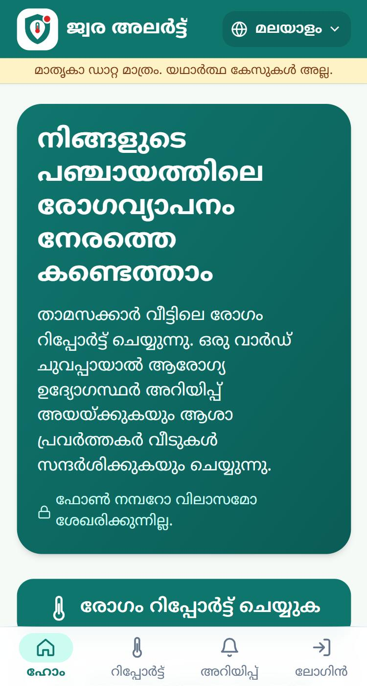
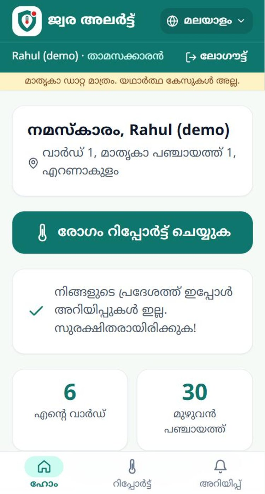
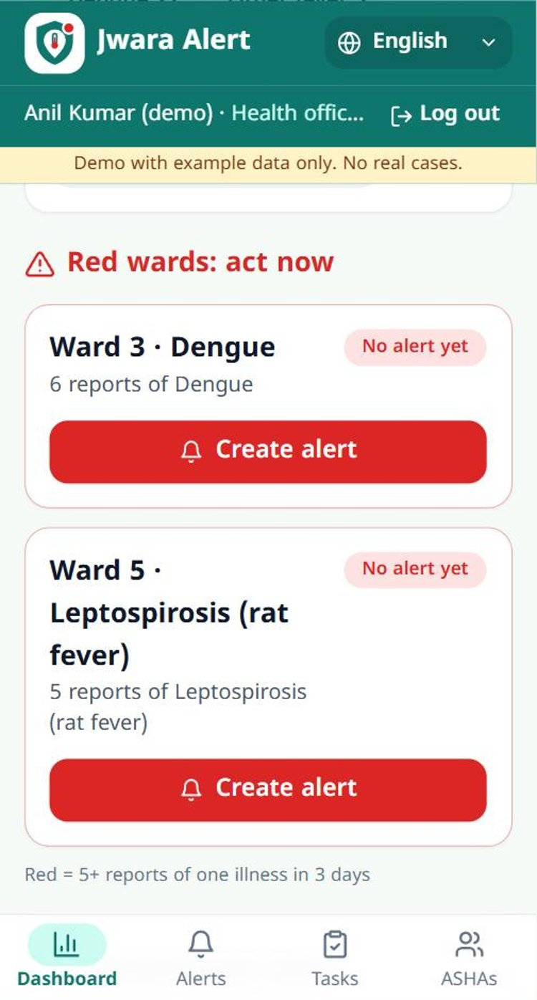
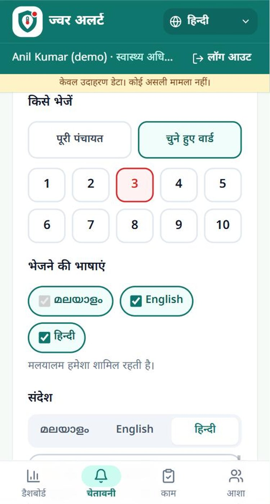
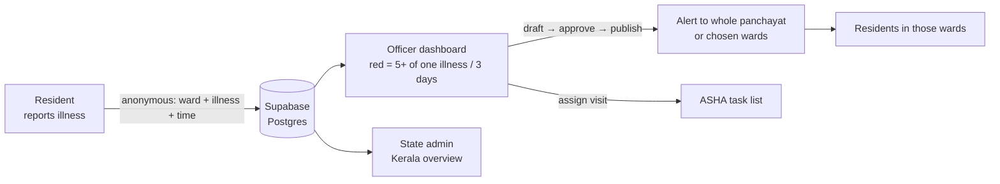

<p align="center">
  
</p>

<h1 align="center">Jwara Alert · ജ്വര അലർട്ട് · ज्वर अलर्ट</h1>

<p align="center">
  <b>Spot illness clusters in Kerala panchayats early, and act on them.</b><br />
  Residents report illness anonymously → a ward turns red → the health officer approves an alert → ASHA workers visit homes.
</p>

<p align="center">
  <a href="https://jwara-alert.vercel.app"><b>Live demo: jwara-alert.vercel.app</b></a><br />
  
  
  
  
</p>

> **All data in this app is fake example data.** No real cases and no real people.
> Built for **Devin Hacks Kochi**, track **"Make the Invisible Visible"**.

<p align="center">
  
  
  
  
  <br /><sub>Home (മലയാളം) · Resident home (മലയാളം) · Officer red wards (English) · New alert (हिन्दी)</sub>
</p>

---

## The problem

Outbreaks such as dengue, rat fever (leptospirosis) and jaundice start as a few sick people in
one ward. Health officers usually find out days later, when hospitals fill up. The early signal
is *invisible*: it sits in individual homes.

## How it works

| 1. Report | 2. Red ward | 3. Alert + visit |
| --- | --- | --- |
| A resident picks a suspected illness on their phone. The ward comes from their account; **no name is stored with a report**. | **5 reports of one illness in one ward within 3 days** turns that ward red on the officer's dashboard. | The officer edits a ready-made Malayalam / English / Hindi alert, **approves it**, and assigns **ASHA home visits** with a due date. Residents of those wards see the alert. |



## Features by role

| Role | What they can do |
| --- | --- |
| **Resident** | Sign up with district → panchayat → ward. Report one of 15 illnesses (one report per 10 minutes). See alerts only for their own area, the latest alert on their home screen, and anonymous counts for their ward and panchayat. |
| **Health officer** (per panchayat) | Self-register, then wait for state approval. Dashboard with illness filter, per-ward chart and red wards, each showing whether an alert was already sent. Create alerts for the whole panchayat or selected wards in up to 3 languages, from fixed templates with illness-specific advice. Draft, edit, publish (with confirmation) or discard. Create and switch off ASHA accounts. Assign visits with due dates and track open, overdue and done. |
| **ASHA worker** | See their own visit list (ward, illness, due date) and tap **"Mark visit done"**. |
| **State admin** (Kerala Health Dept) | Kerala totals, a district table, district drill-down with "no officer" flags, red wards across the state (alerts not yet sent shown first), officer approval, and switching officers off. |
| **Visitor** | Quick report by ward (original demo), public alerts, 108 / 112 emergency buttons. |

**For everyone:** a language switch (**മലയാളം · English · हिन्दी**) on every page. The choice is
remembered on the device and on the account. The app is phone-first with a bottom tab bar,
uses 2-column dashboards on laptops, and can be installed with "Add to Home screen".

## Demo accounts

Created by `npm run seed:accounts`; every password is the `DEMO_PASSWORD` you set.

| Username | Role | Where |
| --- | --- | --- |
| `admin_kerala` | State admin | Kerala |
| `officer_demo` | Health officer (approved) | Ernakulam → Example Panchayat 1 |
| `officer_pending` | Health officer (waiting for approval) | Ernakulam → Example Panchayat 1 |
| `asha_1`, `asha_2` | ASHA workers | Ernakulam → Example Panchayat 1 |
| `citizen_1`, `citizen_2` | Residents | Ward 1 and Ward 2 of that panchayat |

### 2-minute demo script

1. **`officer_demo`** opens the Dashboard. Ward 3 (dengue, 6) and Ward 5 (rat fever, 5) are red and marked "No alert yet".
2. Tap **Create alert** on Ward 3. The illness and ward are pre-filled with ready text in three languages. Tick Ward 1 as well, then **Save draft**, then **Approve and publish**.
3. Under the published alert, **Assign ASHA visit** to Ward 3 for `asha_1`, due in 2 days.
4. **`citizen_1`** (Ward 1) sees the alert. **`citizen_2`** (Ward 2) sees "No alerts in your area". Switch the language to show English and Hindi.
5. **`asha_1`** taps **Mark visit done**. The officer's Tasks page now shows it as done.
6. **`admin_kerala`** sees the Kerala overview, with Ernakulam on top and Ward 3 now "Alert sent".

## Tech

- **Next.js 14** (App Router, server components) · **TypeScript** · **Tailwind CSS**
- **Supabase Postgres**, used **only from the server** with the service-role key. Row Level Security is on with no policies, so the public key can read nothing.
- Custom auth: **bcrypt** password hashes and an **HMAC-signed httpOnly session cookie** (user id + expiry only). Role and approval are read fresh from the database on every request.
- i18n: `lib/i18n/{ml,en,hi}.ts`. TypeScript fails the build if a language misses a key, and `npm run check:i18n` also checks placeholders.
- Fonts: Noto Sans Malayalam and Noto Sans Devanagari. PWA manifest and app icons are included.

## Run locally

```bash
npm install
cp .env.example .env.local      # fill in the values below
npm run dev                     # http://localhost:3000
```

### Database (Supabase SQL editor; every script is safe to re-run and never deletes data)

1. `supabase/schema.sql`: base tables (reports, alerts, tasks)
2. `supabase/migrations/001_phase_a.sql`: districts, panchayats, wards, illnesses, accounts
3. `supabase/migrations/002_phase_bc.sql`: targeted alerts, ASHA tasks, switch-off flag
4. `supabase/migrations/003_i18n_admin.sql`: Hindi names, alert languages, saved language per account
5. Optional fake data: `supabase/demo/phase_bc_demo_reports.sql`, `npm run seed`, `npm run seed:accounts`

### Environment variables (all server-only; none start with `NEXT_PUBLIC_`)

| Variable | Purpose |
| --- | --- |
| `SUPABASE_URL` | Supabase project URL |
| `SUPABASE_SERVICE_ROLE_KEY` | Secret key, used only in server code |
| `SESSION_SECRET` | 32+ random characters; signs login cookies |
| `ADMIN_PIN` | PIN for the quick-demo pages `/dashboard` and `/tasks` |
| `DEMO_PASSWORD` | Local only, for `npm run seed:accounts` |
| `REPORT_COOKIE_SECRET` | Optional; signs the report-cooldown cookie |

### Checks

```bash
npm run typecheck && npm run lint && npm run check:i18n
```

## Deploy on Vercel

1. Import the GitHub repo (framework: Next.js, default settings).
2. Add `SUPABASE_URL`, `SUPABASE_SERVICE_ROLE_KEY`, `SESSION_SECRET` and `ADMIN_PIN` for **Production and Preview**.
3. Deploy. Every pull request gets its own preview link.

## Security and privacy

- Reports store **ward, illness and time only**: no user id, name or phone number.
- Every officer and ASHA action is checked **on the server** for role, approval and **own panchayat**. Wards, ASHAs or alerts from another panchayat are rejected.
- Publishing is guarded so a double tap cannot publish twice. Visits can only be assigned for published alerts.
- Disabled accounts are treated as logged out. Login and sign-up are rate-limited. Login errors do not reveal whether a username exists.
- No AI runs inside the app. Alert text comes from fixed templates and **a human approves every alert**.

## Limits and future work

- Panchayat names are placeholders ("Example Panchayat 1/2"), to be replaced with real LSGD data.
- No SMS or WhatsApp delivery yet; residents see alerts when they open the app.
- Anyone can sign up as a resident. The per-phone cooldown slows spam, and a per-account limit is planned.
- Rate limits are in memory per server instance.

## How AI tools were used

See [`AI_USAGE.md`](AI_USAGE.md). In short: Devin built the first version, Claude built accounts,
roles, languages and the state view, and the team set every product rule and checked the text.
