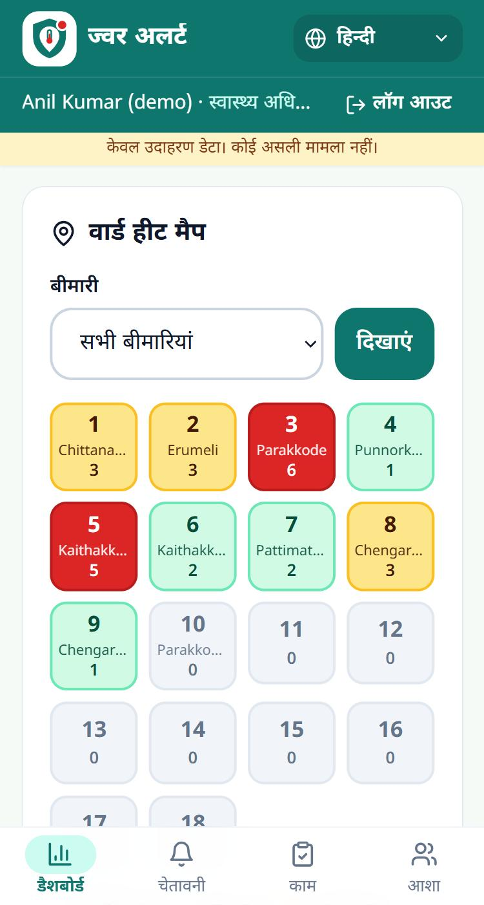
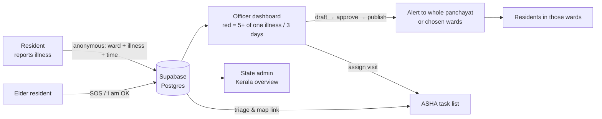

<p align="center">
  
</p>

<h1 align="center">Jwara Alert · ജ്വര അലർട്ട് · ज्वर अलर्ट</h1>

<p align="center">
  <b>Spot illness clusters in Kerala panchayats early, and act on them.</b><br />
  Residents report illness anonymously → a ward turns red → the health officer approves an alert → ASHA workers visit homes.
</p>

<p align="center">
  <a href="https://jwara-alert.vercel.app"><b>Live app: https://jwara-alert.vercel.app</b></a><br />
  
  
  
  
</p>

> **All data in this app is fake example data.** No real cases and no real people.
> Built for **Devin Hacks Kochi**, track **"Make the Invisible Visible"**.

<p align="center">
  
  
  
  
  
  <br /><sub>Home (മലയാളം) · Resident home (മലയാളം) · Officer red wards (English) · Ward heat map (हिन्दी) · New alert (हिन्दी)</sub>
</p>

---

## The problem

Outbreaks such as dengue, rat fever (leptospirosis) and jaundice start as a few sick people in
one ward. Health officers usually find out days later, when hospitals fill up. The early signal
is *invisible*: it sits in individual homes.

## How it works

| 1. Report | 2. Red ward | 3. Alert + visit |
| --- | --- | --- |
| A resident picks a suspected illness on their phone. The ward comes from their account; **no name is stored with a report**. | **5 reports of one illness in one ward within 3 days** turns that ward red on the officer's dashboard. | The officer edits a ready-made Malayalam / English / Hindi alert, **approves it**, and assigns **ASHA home visits** with a due date. Residents of those wards see the alert. |



## Features by role

| Role | What they can do |
| --- | --- |
| **Resident (Citizen)** | Sign up with district → panchayat → named ward (e.g. *Ward 3 · Parakkode*). Optional birth year (chosen from a list), living alone flag, and family contact phone. Report one of 15 illnesses: **one report per 10 minutes per phone and per account**. See alerts only for their own area, the latest alert on their home screen, and anonymous counts for their ward and panchayat. Share an alert on **WhatsApp**.<br/><br/>**Elder Care (aged 60+):** simplified high-contrast home screen with prominent 108 (Ambulance) and 112 (Emergency) call buttons ("This app does not replace an ambulance. In danger, call 108 first."), a big red **SOS** button (sent **at once**; the GPS location is added a few seconds later if the phone allows it, so an unanswered location prompt can never block the SOS; only one active SOS per person), a big green **"I am OK today"** daily check-in button, and a **Large text** toggle that enlarges text and buttons across all pages. *(Note: no real SMS or calls; family members stay informed by logging into the same account).* |
| **Health officer** (per panchayat) | Self-register, then wait for state approval. Dashboard with red wards (each showing whether an alert was already sent), an **active SOS count card** linking to `/officer/sos`, a **ward heat map** (green / amber / red; tap a ward for its illnesses) with an illness filter, and a **7-day trend** per illness marked rising or falling. Create alerts for the whole panchayat or selected wards in up to 3 languages, from fixed templates with illness-specific advice. Draft, edit, publish (with confirmation) or discard. Create and switch off ASHA accounts. Assign visits with due dates (one per ward and ASHA, duplicates blocked) and track open, overdue and done, with each **visit report** and totals for homes visited, fever cases and referrals. Dedicated **/officer/sos** page to accept and resolve SOS alerts. **Hospitals and health centres** page (`/officer/facilities`): add PHC, FHC, CHC, taluk, district or private hospitals with phone, address and a 24-hour flag; residents see them on the public ward page. |
| **ASHA worker** | See active **SOS alerts** at the top of `/home/asha` with Open / Accepted status, an OpenStreetMap pin link, family phone `tel:` call link, and **Accept** / **Resolved** actions. See visit list (ward, illness, due date) with **"Mark visit done"** and short report. View **"Elders in my panchayat"** list with age, ward, living situation, and today's check-in status (un-checked-in elders who live alone highlighted first in red). Register new senior citizens in her panchayat with the **"Add elder"** form. |
| **State admin** (Kerala Health Dept) | Kerala totals (including homes visited and people referred by ASHAs), a **Kerala district map** (tap a district), a district table, district drill-down with "no officer" flags, red wards across the state (alerts not yet sent shown first), officer approval, and switching officers off. |
| **Visitor** (no login) | **"Is my ward safe?"** page (`/ward`): pick a ward and see **Safe / Watch / High alert** (illness names only, no counts, no people), recent officer alerts, health tips for that illness in 3 languages, the panchayat's health centres with Call and Map buttons, DISHA 1056 and 108, and a WhatsApp share link. Also quick report by ward (original demo), public alerts, and 108 / 112 emergency buttons. |

**Places:** all 14 districts, with 2 real grama panchayats in each (28 in total, for example Kunnathunad and Udayamperoor in Ernakulam). They have their real ward counts (493 wards) and ward names for wards 1–10, taken from the LSGD directory list. Kunnathunad is the demo panchayat.

**For everyone:** a language switch (**മലയാളം · English · हिन्दी**) on every page. The choice is
remembered on the device and on the account. The app is phone-first with a bottom tab bar,
uses 2-column dashboards on laptops, and can be installed with "Add to Home screen".

## Demo accounts

Created by `npm run seed:accounts`; every password is the `DEMO_PASSWORD` you set.

| Username | Role | Where | Details |
| --- | --- | --- | --- |
| `admin_kerala` | State admin | Kerala | Oversees all 14 districts |
| `officer_demo` | Health officer (approved) | Ernakulam → Kunnathunad | Health Inspector |
| `officer_pending` | Health officer (waiting) | Ernakulam → Kunnathunad | Junior Health Inspector |
| `asha_1`, `asha_2` | ASHA workers | Ernakulam → Kunnathunad | Assigned to field visits and elder care |
| `citizen_1`, `citizen_2` | Residents | Ward 1 (Chittanadu) and Ward 2 (Erumeli) | Standard resident accounts |
| `elder_1` | Resident (Elder) | Ward 1 (Chittanadu), Kunnathunad | Born 1950, lives alone, family phone `9000000001` |
| `elder_2` | Resident (Elder) | Ward 3 (Parakkode), Kunnathunad | Born 1956, lives with family |

### 2-minute demo script

1. **`officer_demo`** opens the Dashboard. Ward 3 · Parakkode (dengue, 6) and Ward 5 · Kaithakkadu South (rat fever, 5) are red and marked "No alert yet". The heat map shows them in red; tap Ward 3 to see its illnesses. The 7-day trend shows dengue **rising**. The Active SOS card shows the current emergency count.
2. Tap **Create alert** on Ward 3. The illness and ward are pre-filled with ready text in three languages. Tick Ward 1 as well, then **Save draft**, then **Approve and publish**.
3. Under the published alert, **Assign ASHA visit** to Ward 3 for `asha_1`, due in 2 days.
4. **`citizen_1`** (Ward 1) sees the alert and can **share it on WhatsApp**. **`citizen_2`** (Ward 2) sees "No alerts in your area". Switch the language to show English and Hindi.
5. **`asha_1`** taps **Mark visit done** and reports, for example, 12 homes, 3 with fever, 1 referred, plus a note. The officer's Tasks page shows the visit as done, with these numbers and running totals.
6. **Elder Care Flow:**
   - **`elder_1`** logs in: sees high-contrast elder home screen with emergency call buttons (108 / 112) and large typography.
   - **`elder_1`** taps **"I am OK today"** → updates instantly to "Checked in today ✓" with timestamp.
   - **`elder_1`** taps the big red **SOS** button → confirms → "SOS sent. Your ASHA has been told. If it is serious, call 108 now." appears at once; the GPS location is added afterwards if allowed.
   - **`asha_1`** opens `/home/asha`: sees the active SOS alert at the top with Ward 1, timestamp, OpenStreetMap location pin link, and family phone link.
   - **`asha_1`** taps **Accept** (status turns to Accepted) and then **Resolved**.
   - **`asha_1`** checks **"Elders in my panchayat"**: `elder_1` shows "Checked in today", while any alone elder without a check-in is flagged in red at the top.
7. **Without logging in**, open **`/ward`** (or the "Is my ward safe?" card on the home page), choose Ernakulam → Kunnathunad → Ward 3: it shows **High alert · dengue** with mosquito tips. As `officer_demo`, add the local PHC on **Hospitals and health centres**; it appears on the ward page with a Call button.
8. **`admin_kerala`** sees the Kerala map with Ernakulam (EKM) in red. Tap it to open the district, where Ward 3 now shows "Alert sent".

## Tech

- **Next.js 14** (App Router, server components) · **TypeScript** · **Tailwind CSS**
- **Supabase Postgres**, used **only from the server** with the service-role key. Row Level Security is on with no policies, so the public key can read nothing.
- Custom auth: **bcrypt** password hashes and an **HMAC-signed httpOnly session cookie** (user id + expiry only). Role and approval are read fresh from the database on every request.
- i18n: `lib/i18n/{ml,en,hi}.ts`. TypeScript fails the build if a language misses a key, and `npm run check:i18n` also checks placeholders.
- Fonts: Noto Sans Malayalam and Noto Sans Devanagari. PWA manifest and app icons are included.

## Run locally

```bash
npm install
cp .env.example .env.local      # fill in the values below
npm run dev                     # http://localhost:3000
```

### Database (Supabase SQL editor; every script is safe to re-run and never deletes data)

1. `supabase/schema.sql`: base tables (reports, alerts, tasks)
2. `supabase/migrations/001_phase_a.sql`: districts, panchayats, wards, illnesses, accounts
3. `supabase/migrations/002_phase_bc.sql`: targeted alerts, ASHA tasks, switch-off flag
4. `supabase/migrations/003_i18n_admin.sql`: Hindi names, alert languages, saved language per account
5. `supabase/migrations/004_real_places.sql`: real panchayat names (renamed in place), ward counts and names, per-account report limit
6. `supabase/migrations/005_visit_report.sql`: ASHA visit report columns and one visit per alert + ward + ASHA
7. `supabase/migrations/006_elder_care.sql`: elder care profiles, SOS requests table, daily check-ins table
8. `supabase/migrations/007_sos_one_active.sql`: one active SOS per person (unique index)
9. `supabase/migrations/008_alert_client_ref.sql`: one draft per "New alert" form (stops double drafts from two tabs)
10. `supabase/migrations/009_login_failures.sql`: failed logins per username, so the login limit works on every server
11. `supabase/migrations/010_health_facilities.sql`: hospitals and health centres per panchayat
12. `supabase/migrations/011_facility_unique_name.sql`: one entry per health centre name in a panchayat
13. Optional fake data: `supabase/demo/phase_bc_demo_reports.sql`, `npm run seed`, `npm run seed:accounts`

### Environment variables (all server-only; none start with `NEXT_PUBLIC_`)

| Variable | Purpose |
| --- | --- |
| `SUPABASE_URL` | Supabase project URL |
| `SUPABASE_SERVICE_ROLE_KEY` | Secret key, used only in server code |
| `SESSION_SECRET` | 32+ random characters; signs login cookies |
| `ADMIN_PIN` | PIN for the quick-demo pages `/dashboard` and `/tasks` |
| `DEMO_PASSWORD` | Local only, for `npm run seed:accounts` |
| `REPORT_COOKIE_SECRET` | Optional; signs the report-cooldown cookie |

### Checks

```bash
npm run typecheck && npm run lint && npm run check:i18n
```

## Deploy on Vercel

1. Import the GitHub repo (framework: Next.js, default settings).
2. Add `SUPABASE_URL`, `SUPABASE_SERVICE_ROLE_KEY`, `SESSION_SECRET` and `ADMIN_PIN` for **Production and Preview**.
3. Deploy. Every pull request gets its own preview link.

## Security and privacy

- Reports store **ward, illness and time only**: no user id, name or phone number. The per-account limit keeps only the time of the account's last report, and that time is claimed with one conditional update, so two quick taps cannot both count.
- Every officer and ASHA action is checked **on the server** for role, approval and **own panchayat**. Wards, ASHAs or alerts from another panchayat are rejected.
- SOS requests and check-ins are strictly validated and scoped to the user's session panchayat and ward. A unique index allows **one active SOS per person**, so parallel taps return the same SOS. Check-ins are one per person per India (Asia/Kolkata) day.
- The public ward page shows only a level and illness names for a ward. It never shows counts, names or report times.
- Duplicate-safe saves: one draft per alert form, one visit per alert + ward + ASHA, one health centre per name.
- Publishing is guarded so a double tap cannot publish twice. Visits can only be assigned for published alerts.
- Disabled accounts are treated as logged out. Login is limited per username in the database (10 failures per 15 minutes, on every server) and per IP in memory. Sign-up is rate-limited. Login errors do not reveal whether a username exists.
- **Passwords:** new passwords need 8+ characters with letters and numbers, must not be a common password or contain the username, and are hashed with **bcrypt (cost 12)**. Older hashes are upgraded to cost 12 at the next successful login. Login compares against a dummy hash for unknown usernames, so timing does not reveal which usernames exist. Every password field has Show / Hide.
- **Sessions:** HMAC-signed, httpOnly, Secure, SameSite=Lax cookie holding only the user id and expiry (7 days).
- **Cross-site requests:** `middleware.ts` refuses any API write whose `Origin` is another site.
- **Security headers** on every page (`next.config.mjs`): Content-Security-Policy (scripts, styles, fonts and images only from this site; no framing), X-Frame-Options DENY, nosniff, strict Referrer-Policy, Permissions-Policy (location only for this site; no camera or microphone), HSTS, and Cross-Origin-Opener-Policy.
- No AI runs inside the app. Alert text comes from fixed templates and **a human approves every alert**.

## Limits and future work

- Only 2 panchayats per district are loaded (Kerala has about 941). Wards 11 and above have numbers but no names yet.
- No automatic SMS or WhatsApp sending. Family members monitor elder SOS status by logging into the same resident account.
- Anyone can sign up as a resident. Limits per phone and per account slow spam but cannot stop many fake accounts.
- The Kerala map is a schematic tile map, not a geographic boundary map.
- The sign-up limit (and the first login layer) is in memory per server instance; the per-username login limit is in the database.
- The health centre list is empty until the panchayat officer adds official phone numbers. No numbers are pre-filled.
- Ward status uses the same simple rule as the dashboard (5 reports of one illness in 3 days). It is an early signal, not a diagnosis.

## How AI tools were used

See [`AI_USAGE.md`](AI_USAGE.md). In short: **Devin built the foundation**: the first working app, anonymous reporting, the red-ward rule that every view still uses, and human-approved alerts. Claude built accounts,
roles, languages and the state view, Antigravity built elder care, SOS and daily check-ins, Claude fixed the bugs found in audits and built the public ward page and health centres, and the team set every product rule and checked the text.
